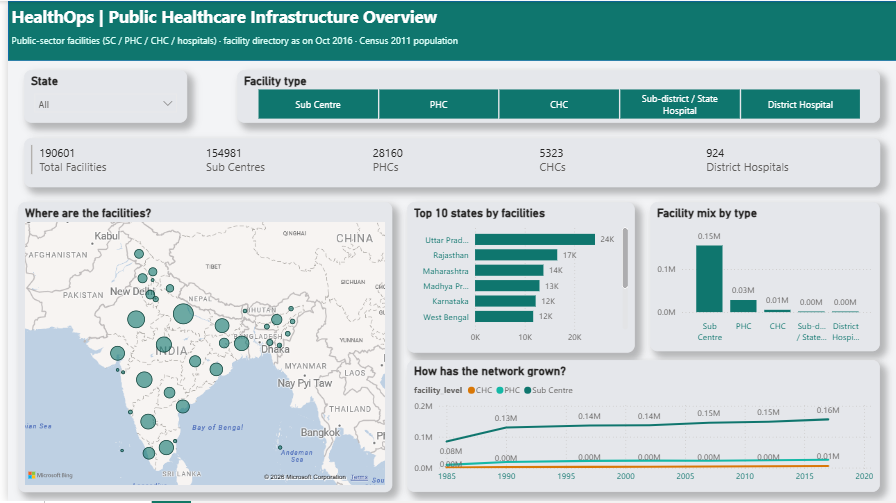
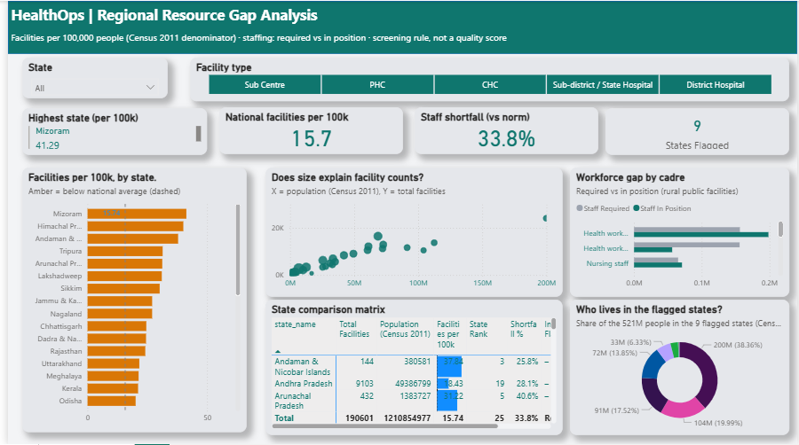

# HealthOps — Public Healthcare Infrastructure & Resource Gap Analysis (India)

A two-page Power BI report on India's public healthcare infrastructure: where facilities are, how they compare per head of population, and where the rural workforce falls short of the government norm.




> Screening tool, not a quality assessment. Counts of public facilities do not measure care quality or need.

## Data
| Source | Publisher | Period | Used for |
|---|---|---|---|
| All India Health Centres Directory (`geocode_health_centre.csv`) | Ministry of Health & Family Welfare, via data.gov.in (Kaggle copy used) | as on Oct 2016 | Facility counts, type, state, coordinates |
| Rural Health Statistics 2017 (21 CSVs) | Ministry of Health & Family Welfare | as on 31 Mar 2017 | Staffing (required vs in position), trend 1985-2017 |
| Census of India 2011, state totals | Registrar General of India | 2011 | Population denominator |

Scope limits: public sector only; no beds, patients or utilisation; staffing is rural facilities only; 2016-17 counts against 2011 population.

## Pipeline
`python/build_clean.py` reads the raw files and writes cleaned tables to `data/clean/` (190,601 facilities, 36 states/UTs). Every exclusion and repair is logged in `data_quality_log.csv`; counts are reconciled to Rural Health Statistics in `validation_directory_vs_rhs.csv`.

Key data-quality decisions: excluded 9,829 pre-split "Andhra Pradesh Old" rows (double-count with Andhra Pradesh/Telangana); repaired 2 shifted rows; removed 8 exact duplicates; corrected 134 swapped coordinates; kept 492 facilities with unusable coordinates in counts but off the map.

## Model (Power BI)
Star schema: `dim_state`, `dim_facility_type` → `fact_facility`, `fact_staffing`, `fact_trend` (one-to-many, single direction, joined on a cleaned `state_key`). About 25 DAX measures in `_Measures` (facilities per 100k, rank, difference vs national, shortfall %, screening flag).

## Report
- **Page 1 — Infrastructure overview:** KPI cards, bubble map, top-10 states, facility mix, growth by Five-Year Plan.
- **Page 2 — Regional resource gap:** national benchmark, ranked rate with benchmark line, population-vs-facilities scatter, workforce by cadre, state matrix, flagged-states table.

## Headline results
- 190,601 public facilities; 81% are Sub Centres.
- National rate 15.7 per 100,000 people; range 4.6 (Delhi) to 41.3 (Mizoram), about 9×.
- Staffing: 33.8% of required rural posts unfilled; surgeons and physicians at CHCs about 85% below norm.
- Flag (below-median rate AND above-median shortfall): 9 states/UTs; Bihar and Uttar Pradesh are the largest.

## How to reproduce
1. Download the raw files (links above) into `data/raw/` (directory CSV) and `data/raw/rhs2017/` (Rural Health Statistics CSVs).
2. Run `python python/build_clean.py` to regenerate `data/clean/`.
3. Open `powerbi/HealthOps.pbix`. If Power BI asks, point each table to the matching CSV in `data/clean/` (Home > Transform data > Data source settings).

## Tools
Power BI Desktop (Power Query, data model, DAX), Python (pandas) for cleaning and validation.

## Author
<Tanishka badhai > - <[LinkedIn link](https://www.linkedin.com/in/tanishka-b-37462b323/)>

## Folder
```
HealthOps/
  data/raw/            (downloaded files, not committed)
  data/clean/          (output of build_clean.py)
  python/              build_clean.py
  powerbi/             HealthOps.pbix
  screenshots/         page1.png, page2.png
```
